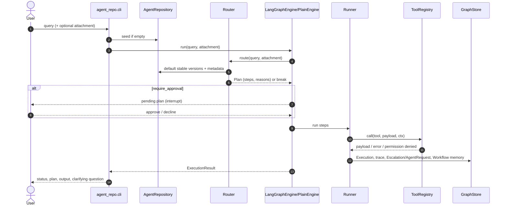
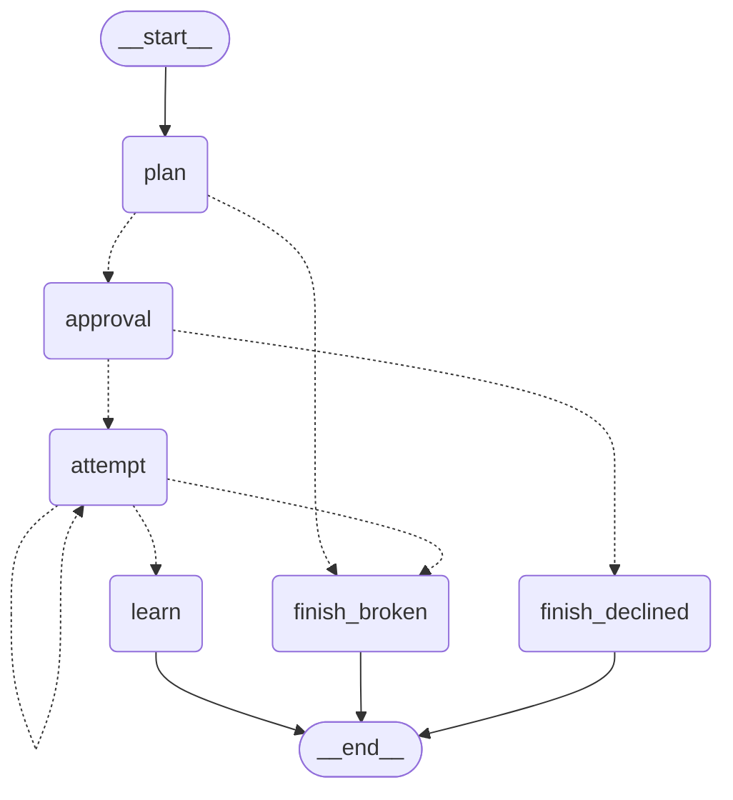

# Architecture

## Components

| Module | Responsibility |
| --- | --- |
| `agent_repo/manifest.py` | Frozen `AgentManifest` (+ `PipelineStep`), `Modality`, `RiskTier`, `Status`, canonical JSON and SHA-256 content hash. |
| `agent_repo/repository.py` | Versioning and governance enforced in code; `describe()`, `reachable_tools()`, `catalog_markdown()`, `verify_integrity()`. |
| `agent_repo/routing.py` | Fact extraction, scoring, BFS prerequisite insertion, workflow memory, `Plan`/`PlanStep`, `BreakReason`, `Router`. |
| `agent_repo/execution/runner.py` | Shared policy functions, event-sourced `ExecutionTrace`, breakpoint messages, `Runner`. |
| `agent_repo/execution/engines.py` | Shared node functions plus `PlainEngine` and `LangGraphEngine` (`StateGraph`, optional interrupt). |
| `agent_repo/feedback.py` | Feedback validation, automatic `Case`s, evaluation gate, proposal lifecycle, workflow re-pointing/rollback. |
| `agent_repo/tools.py` | `ToolRegistry` (risk tiers, code-enforced grants, audit log); two real deterministic tools; `audio_transcribe`/`image_classify` with opt-in real providers (Groq ASR, Gemini vision) or labelled stubs; `image_generate`/`email_send` as labelled stubs. |
| `agent_repo/privacy.py` | `scrub()` / `scrub_obj()` regex rules and the salted-HMAC `UserIdHasher`. |
| `agent_repo/actors.py` | Human-name convention used by governance checks (not authentication). |
| `agent_repo/llm.py` | `LLMProvider`, deterministic `MockLLM`, `LangChainLLM`, `make_llm()`. |
| `agent_repo/seeds.py` | The seven seed agents. |
| `agent_repo/config.py` | `Settings.from_env()` → `RouterConfig`, `ExecutionLimits`, `Neo4jSettings`. |
| `agent_repo/graph/store.py` | `GraphStore` protocol, shared schema/immutability checks, `InMemoryGraph`. |
| `agent_repo/graph/neo4j_store.py` | Neo4j 5 / AuraDB backend (managed transactions, batched seeding, early actionable errors, no delete method). |
| `agent_repo/graph/views.py` | `execution_subgraph()`, text renderer, `export_cypher()`. |
| `agent_repo/cli.py` | `argparse` CLI wiring all of the above. |

Both graph backends satisfy the same `GraphStore` protocol and run the same shared checks, so the
repository, router, runner and tests are backend-independent.

## Data flow

## LangGraph state graph

`agent_repo/execution/engines.py` builds this `StateGraph` (diagram produced by
`LangGraphEngine.mermaid_diagram()` from the installed LangGraph):

- `attempt` loops back to itself to try the next alternative workflow.
- `plan -> finish_broken` covers a routing break (`no_match`, `missing_input`) before any step runs.
- `approval -> finish_declined` covers a human declining the plan.
- With `require_approval=True`, `LangGraphEngine` compiles with `interrupt_before=["approval"]`
  (checkpointer `MemorySaver`), so `start()` returns `PendingApproval(thread_id, plan)` and
  `resume(pending, approved=…)` continues.

`PlainEngine` executes the *same* `node_plan → node_approval → node_attempt → node_learn` functions
and the same policy helpers directly, which is why the two engines agree on identical scenarios.

## Backends and configuration

- **AuraDB (verified):** set `NEO4J_URI` (+ user/password) in `.env`; `Neo4jGraph` is used.
- **In-memory (verified offline):** used when no URI is configured; `--graph-file` persists it as
  JSON between CLI commands.
- **Docker (optional, unverified):** `deploy/optional/docker-compose.yml` is provided but has not
  been run; do not describe it as verified.

Routing weights, thresholds and execution limits are configuration
(`RouterConfig`, `ExecutionLimits`, `AGENT_REPO_*` environment variables), never hardcoded in logic.
Real tool providers are selected the same way (`ToolSettings`: `AGENT_REPO_TRANSCRIBER`,
`AGENT_REPO_IMAGE_CLASSIFIER`); the deterministic stubs remain the default, so tests and the demo
stay offline. See [`TOOL_INTEGRATIONS.md`](TOOL_INTEGRATIONS.md).
