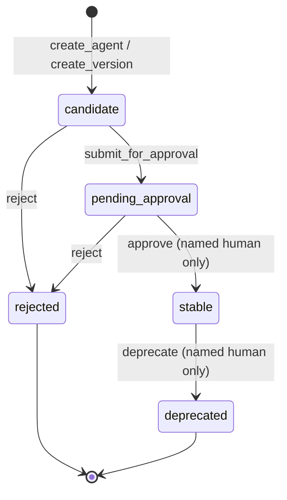

# Versioning

An `AgentVersion` is the frozen manifest of one agent at one point in time. Every version carries a
canonical-JSON SHA-256 `content_hash`; `verify_integrity()` recomputes it and reports any mismatch or
unparsable manifest.

## Status state machine

Allowed transitions (`agent_repo/repository.py`):

| From | Allowed to | Who |
| --- | --- | --- |
| `candidate` | `pending_approval`, `rejected` | any named actor |
| `pending_approval` | `stable`, `rejected` | `stable`/`deprecated` require a **named human** |
| `stable` | `deprecated` | named human only |
| `deprecated` | — (terminal) | — |
| `rejected` | — (terminal) | — |

Any other transition raises `TransitionError`.

## Rules enforced in code

- **Immutability.** Manifests are frozen (`extra="forbid"`); the stored `manifest_json`,
  `content_hash`, `agent`, `version`, `version_seq`, `author` and `created_at` cannot be changed
  after creation. `create_version()` refuses a manifest identical to its parent.
- **Supersede, never overwrite.** A new version is linked to its parent by `SUPERSEDES`; the parent
  remains stored and queryable.
- **Nothing is hard-deleted.** "Delete" is the `deprecated` status (`deprecate()`); there is no
  delete operation on `GraphStore`.
- **New versions always start as `candidate`.** Nothing can be created directly as `stable`.
- **Only a named human may promote to `stable`, deprecate, or change an agent's default version.**
  Authors/reviewers named `llm*` or `system*` (case-insensitive) are refused. This is a **naming
  convention, not authentication** — see [`SAFETY_AND_PRIVACY.md`](SAFETY_AND_PRIVACY.md).
- **Non-human authors** (`llm*`, `system*`) may not: create an agent's **first** version, change its
  **input/output modalities**, or introduce a **HIGH-risk tool** directly or through a pinned
  sub-agent (`_check_manifest`, `reaches_high_risk`).
- **A learned improvement applies to a query type, not globally.** Approving `0.2` creates/points a
  new `Workflow` for that query type; it does **not** change the agent's `default_version`
  (`approve_proposal` verifies the default is unchanged).
- **Default must be `stable`.** `set_default_version()` refuses to point at a non-stable version.
- **Version everything.** Because the whole manifest (prompt, provider, model, pipeline, tools,
  sub-agent pins) is inside the hashed JSON, any change to any of those creates a new version.
- **Sub-agent contracts.** A sub-agent step is version-pinned, and the pinned version must currently
  be `stable`; unknown tools and unknown/missing sub-agents are refused.

`AgentVersion` nodes also record `pending_approval_by/at`, `stable_by/at`, `deprecated_by/at` and a
scrubbed `status_reason` as the lifecycle progresses.
